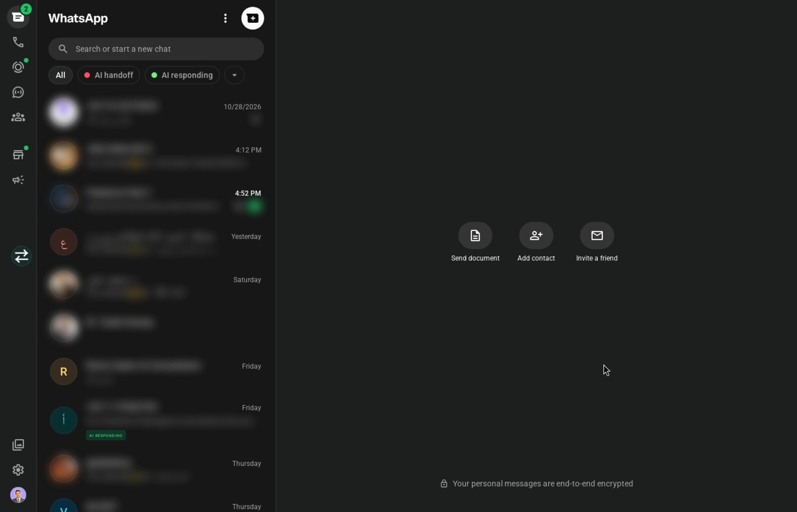
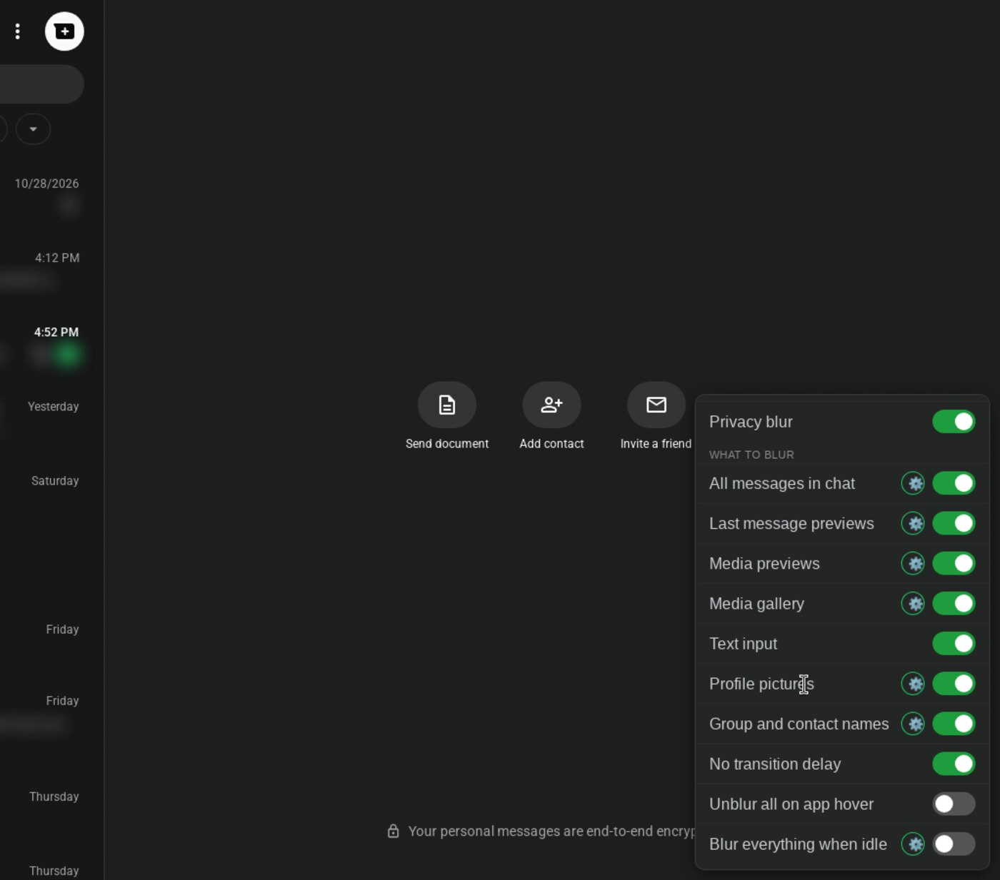

<p align="center">
  
</p>

# whatRust

whatRust is a desktop app for WhatsApp Web, built with Rust and Tauri. It uses your system's webview and keeps each WhatsApp account signed in separately. This fork adds tools for catching up on chats, keeping track of replies, and answering directly from an alert.

[Install whatRust](#install-whatrust) · [What this fork adds](#what-this-fork-adds) · [What stays on your computer](#what-stays-on-your-computer) · [Build from source](#build-from-source)

## Install whatRust

These **0.6.16** installers are built from this fork. Pick the one for your computer.

| Your computer | Download |
| --- | --- |
| Windows 10 or 11, Intel or AMD | [Windows x64 installer](https://github.com/evdev/whatRust/raw/refs/heads/master/installers/whatRust_0.6.16_x64-setup.exe) |
| Windows 10 or 11, ARM64 | [Windows ARM64 installer](https://github.com/evdev/whatRust/raw/refs/heads/master/installers/whatRust_0.6.16_arm64-setup.exe) |
| Mac with Apple Silicon | [macOS disk image](https://github.com/evdev/whatRust/raw/refs/heads/master/installers/whatRust_0.6.16_aarch64.dmg) |

[SHA-256 checksums](installers/SHA256SUMS)

**Windows.** Run the installer over your existing copy to upgrade. You can also run this in PowerShell to let the script choose the installer for your CPU and verify its checksum before opening it.

```powershell
irm https://raw.githubusercontent.com/evdev/whatRust/master/install.ps1 | iex
```

The wizard offers to install the transcription tools. You can skip that step and set them up later in **Settings → Transcription**. It keeps any tools and models you've already installed. For a silent install, use `/S`. Add `/TRANSCRIBE` if you want the optional tools installed too.

**macOS.** Open the disk image and drag whatRust into Applications. The app is unsigned. If macOS says the downloaded app is damaged, run the following in Terminal for this copy of whatRust, then open it again.

```bash
xattr -dr com.apple.quarantine /Applications/whatRust.app
```

**Linux.** Build this fork from source for the features described below. The original project publishes Linux Flatpak, AppImage, and `.deb` downloads. [Upstream releases](https://github.com/karem505/whatRust/releases/latest)

When whatRust opens, scan the QR code from **WhatsApp → Linked Devices → Link a Device** on your phone. The app keeps the login for next time.

## What this fork adds

### See the message and reply from the alert

Open **Settings → Notifications**, choose an account, and turn on alerts for the events you care about: a personal mention, a reply to one of your messages, a direct message, or a group `@everyone` tag. You can choose the sound and reply popup separately for each account, and use a custom sound. These alerts work in muted chats and while whatRust is in the foreground.

On Windows and macOS, reply popups appear in the top-right corner of the display containing the foreground window. They float above other app windows and leave keyboard focus where it is until you interact with the popup.
Drag the title bar to move a popup, or drag an edge or corner to resize it.

The popup shows who wrote, the message, and a photo preview when available. You can play an incoming voice note, read its transcript when transcription is enabled, or reply with text, a file, a photo, or a recorded voice note. **Open Chat** takes you to the conversation for that account. The popup replaces the ordinary notification for that message. Repeat reports of the same photo are filtered, and different photos still get their own alerts.

### Transcribe voice notes and videos

In **Settings → Transcription**, turn on **Transcribe voice notes** to see the words under each note. Enable **Transcribe videos** to add a **Transcribe** button to supported videos. whatRust transcribes the audio locally and keeps the transcripts on this computer, separately for each account.

- **Windows x64:** Open FluidVoice, download a speech model, and enable its local API. Then click **Test connection** in whatRust. whatRust detects the Windows beta on port `47610` and reads its token from FluidVoice's settings, so the older default port setting can stay as it is.
- **Windows ARM64:** Use **GenieX CLI** and download **Qwen3-ASR 0.6B Q8** from the Transcription settings. This requires a supported Snapdragon NPU and about 1.1 GiB for the model.
- **Other builds that use FluidVoice:** Run FluidVoice with its local API enabled. The default port is `47733`.

Under **Settings → Transcription → AI provider**, choose Claude Code, Codex, or Antigravity CLI to translate transcripts and summarize transcripts or chats using your CLI sign-in. Sign in through the CLI first. These options require a native install. You can also select OpenRouter API, Gemini API, or Anthropic API and save an API key. You can choose separate models for translation and summaries. When you change the translation language, provider, or model, whatRust refreshes translations already on screen. Once you summarize a transcript, you can turn it into a to-do.

### Search voice and video transcripts

Type in the regular chat search box and choose **Transcripts** below it to search saved voice-note and video transcripts for the active account. You can also open transcript search with **Ctrl+Alt+F** (**Cmd+Option+F** on Mac). Select a match to jump to the original message. Search runs locally and includes existing saved transcripts.

The Windows installers include transcript search. On macOS, it’s available in builds from the current source.

### Catch up on a chat

Open the chat header menu and choose **Create summary**. Pick **Last hour**, **Last 4 hours**, **Today**, or **Last 3 days**. The result appears under the newest message it covers. It includes existing voice note and video transcripts where available, and tells you when older messages were unavailable or the range had to be shortened.

The summary is a local card you can copy, refresh, or delete. Cancelling a refresh keeps the previous summary. whatRust asks before sending chat text to the provider the first time. You can revoke access in **Settings → Transcription → Chat summaries**.

### Keep track of who owes a reply

Right-click a message and choose **Add to To-Do**, **Waiting on them**, or **I owe a reply**. To-dos can have due dates, reminders, priorities, and repeats. Reply watches live in the separate **Replies** view. They can clear when the expected person sends a later message in that chat, and you can also clear them yourself.

Open **To-Do** or **Replies** near the account switcher to see what's outstanding and jump back to the message. Each account has its own lists. Reminders can fire while whatRust is in the tray. If the app was closed when a reminder came due, you'll see it next time you open the app.

### Schedule a message

In a source build, click the clock beside **Send** to schedule a draft or select photos, videos, and files. If whatRust cannot verify the files in WhatsApp’s attachment preview, select them again in the scheduling dialog. Choose a one-time send or a repeat in days, weeks, months, or years. A repeat keeps the time zone saved with it and can end on a date or after a set number of successful sends. Open **Scheduled messages** from the account controls to review, edit, or cancel upcoming messages.

Schedules and attachment copies stay on this computer across restarts. whatRust can deliver through its connected WhatsApp session while open or in the tray. If a send comes due while the app is closed or the session is unavailable, whatRust asks you to send or skip it when you return. For repeats, the review shows the latest missed send.

### Let the stand-in answer while you're away

Turn on **Allow stand-in** in **Settings → Stand-in**, then enable it from the header of an individual chat. Each chat starts off. You can write general instructions for how you like to reply and add notes for that particular conversation. In each chat, choose an AI reply or a canned reply using the shared default or a custom message. Edit the default in Stand-in settings. Canned replies are sent at most once every two hours per chat; messages arriving during that interval do not trigger a later reply.

The stand-in can search available chat history and transcripts. It pauses when you reply yourself and can stay quiet and alert you when it isn't sure what to say. You can set a reply delay and hourly limit. Messages it sends are marked in the conversation. If WhatsApp rejects a send, the app shows an error and leaves the incoming message unanswered. When the app starts, it checks for recent replies before answering anything that came in while it was opening.

Use the saved provider API key, a signed-in Claude Code, Grok, Codex, or Antigravity CLI, a Hermes service on your private network, or Grok Bot. The CLI options require a native install. Hermes and Grok Bot have per-chat tool access settings. whatRust sends the reply through the linked WhatsApp session. The stand-in runs only while whatRust is open and the computer is awake.

### Accounts, language, and everyday use

- **Accounts.** Add, rename, reorder, remove, or pick the account that opens first in **Settings → Accounts**. Accounts have separate logins and load as you open them. Opening another account leaves the first connected. Windows uses an account switcher, and you can use separate windows where supported. Multiple accounts on macOS require macOS 14 or later. Removing an account also removes its saved summaries, transcripts, to-dos, and stand-in files.
- **English by default.** Settings and the whatRust interface open in English by default. Brazilian Portuguese is available under **Settings → Appearance → Language**, and an existing choice is kept. The language for transcript translation is separate.
- **Source device.** The icon next to a message's timestamp can suggest Apple, Android, or a computer when the message ID gives a clue. You can turn it off under **Settings → Appearance**.
- **Fewer interruptions.** Connection recovery can reload WhatsApp when **Reconnect** gets stuck. The app keeps opened accounts connected while hidden in the tray. On macOS, whatRust can import an existing WebKit key once to avoid repeated login keychain prompts.

## What stays on your computer

Transcription audio is processed locally. The resulting transcripts, saved summaries, to-dos, reply watches, and stand-in instructions are stored on this computer. A saved chat summary is a card inside whatRust and won't appear on your phone or in the conversation.

Translation sends the transcript text to your chosen provider. Summarizing a chat sends the text for the selected range, including other people's messages and any available transcripts in that range. The stand-in sends the context it uses to the backend you choose. A signed-in CLI uses its own account, and a connected agent may retain chat context or use tools according to its settings. Only enable these features in chats whose content you're comfortable sharing with that service.

## Desktop features and platform notes

- The tray shows the combined unread count. You can keep whatRust in the tray when you close its window, launch it at startup, and show or hide it with **Ctrl/Cmd+Shift+W**. On Wayland, set a desktop shortcut for `whatrust --toggle`. For Flatpak, use `flatpak run io.github.karem505.whatRust --toggle`.
- **Settings → Security** offers a password and, where supported, biometric unlock. You can lock on launch, on demand, when hiding to the tray, or after idle time. App lock protects access to the window. Use your operating system's disk encryption to protect data on disk.
- Drag files into a conversation to attach them. Download notices offer **Open** or **Show in folder**, and you can choose your download folder, app icon, and interface size in Settings. Ordinary web links open in your browser, and `whatsapp://` links can open a chat in whatRust.
- **Settings → Network** supports HTTP and SOCKS5 proxies. Restart after changing the proxy. Proxies that require credentials need a local relay.
- Voice messages are supported. Voice and video calls work on Windows and macOS when WhatsApp enables browser calling for your account. Both call types were verified in this fork’s 0.6.16 Windows ARM64 test build. During a call on Windows, choose **Move to New Window** to open it in a movable, resizable window. Linux builds do not currently support calls. Press **Ctrl/Cmd+Shift+P** to open the privacy blur controls before sharing your screen.
- **Settings → Updates** checks this fork's GitHub releases and verifies release downloads against their published checksums. You can also upgrade a checked-in build by running the installer linked above.

whatRust uses WebView2 on Windows, WKWebView on macOS, and WebKitGTK on Linux. The Linux build needs WebKitGTK 2.46.1 or newer for WhatsApp's QR login. The macOS build targets Apple Silicon and requires macOS 12.1 or newer.

## Video and screenshots

The upstream demo shows the app layout, account windows, and privacy blur. [Watch the demo](docs/media/whatrust-video.mp4)

| WhatsApp with privacy blur | Privacy blur controls |
| --- | --- |
|  |  |

## Build from source

Clone this fork and install the [Tauri prerequisites](https://v2.tauri.app/start/prerequisites/) for your operating system. For Linux, the project's build dependencies are listed in the [check workflow](.github/workflows/check.yml).

```bash
git clone https://github.com/evdev/whatRust.git
cd whatRust
cargo install tauri-cli --version "^2.0" --locked
cargo tauri dev
```

Run `cargo tauri build` to package the app. See the [installer notes](installers/README.md) for how this fork publishes its downloads.

## Credits and license

This is a fork of [karem505/whatRust](https://github.com/karem505/whatRust). You can [support the original developer](https://github.com/sponsors/karem505) or [report an issue with this fork](https://github.com/evdev/whatRust/issues).

whatRust is independent of WhatsApp and Meta. It runs the official WhatsApp Web interface inside the desktop app. The code is available under the [MIT License](LICENSE).
